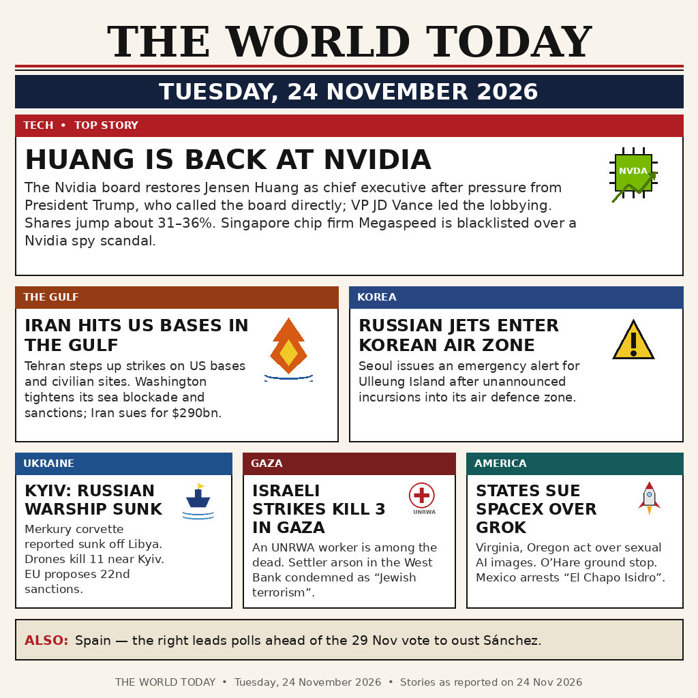

# THE WORLD TODAY — Tuesday, 24 November 2026

[](https://make.fun/bounty/news-image-20261124)
[](https://make.fun/bounty/news-image-20261124/leaderboard)
[](https://make.fun/bounty/news-image-20261124/submissions)

Entry for the make.fun bounty **[Sum up 24 November's world news in one image](https://make.fun/bounty/news-image-20261124)** — a one-page newspaper that sums up the world news of Tuesday, 24 November 2026.



## The day in six stories

- **Top story — NVIDIA:** the board restores Jensen Huang as CEO after pressure from President Trump; shares jump about 31–36%; Singapore chip firm Megaspeed is blacklisted over a Nvidia spy scandal.
- **The Gulf:** Iran steps up strikes on US bases and civilian sites; the US tightens its sea blockade and sanctions; Iran sues for $290bn.
- **Korea:** Russian jets enter South Korea's air defence zone; Seoul issues an emergency alert for Ulleung Island.
- **Ukraine:** Kyiv says it sank the Russian corvette Merkury off Libya; Russian drones kill 11 near Kyiv; the EU proposes a 22nd sanctions package.
- **Gaza:** Israeli strikes kill 3 in Gaza, including an UNRWA worker; settler arson in the West Bank is condemned as "Jewish terrorism".
- **America:** Virginia and Oregon sue SpaceX over sexual AI images from Grok; O'Hare ground stop amid Thanksgiving travel; Mexico arrests "El Chapo Isidro".
- **Also:** Spain — the right leads polls ahead of the 29 Nov vote to oust Sánchez.

## How it works

- `build_image.py` renders `entry.png` (1024×1024, ≤1 MiB) with Pillow and DejaVu fonts. It is a build-time helper, not run by the grader.
- `main.py` (Python 3.13, stdlib only) validates `entry.png` (PNG magic, 1024×1024 IHDR, ≤1 MiB, every chunk CRC) and copies it to `$MAKEFUN_OUTPUT_DIR` (default `/output`). No network, no secrets.
- The image is deterministic: `main.py` copies the same bytes on every run.

## Run locally

```sh
python3 build_image.py          # render entry.png
mkdir -p out && MAKEFUN_OUTPUT_DIR=out python3 main.py
```

---

Built for [make.fun](https://make.fun/bounty/news-image-20261124) — referral: `na41kg1z`
